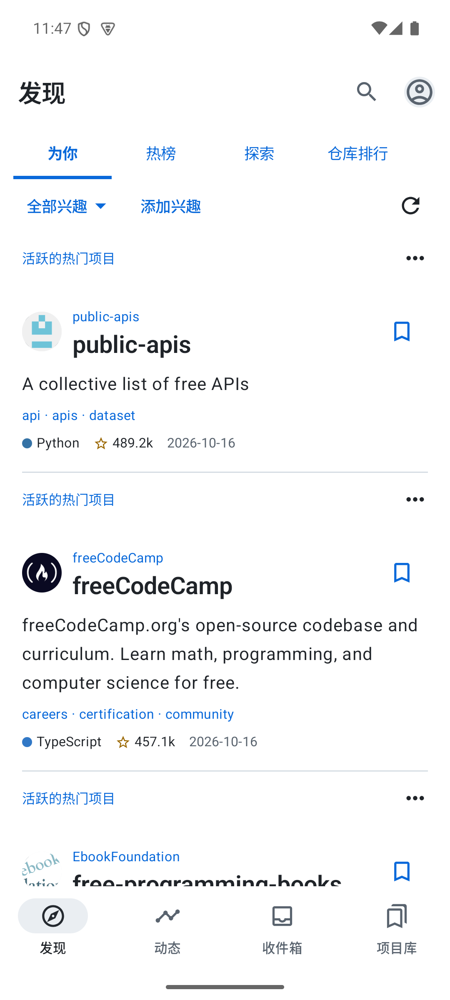
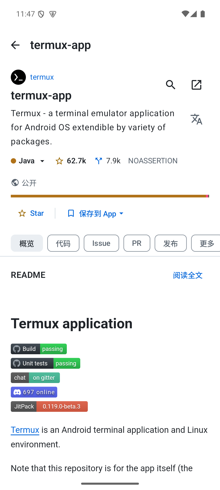
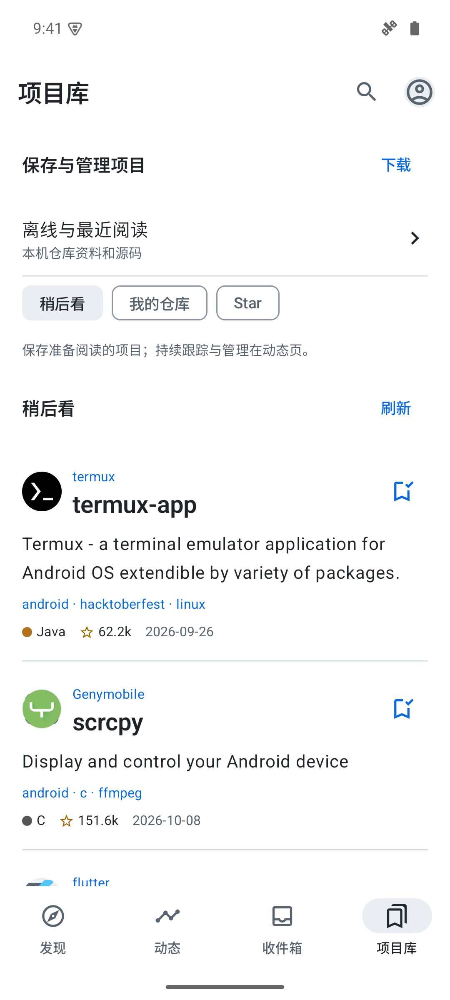
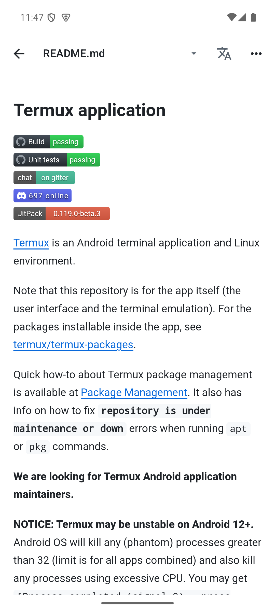
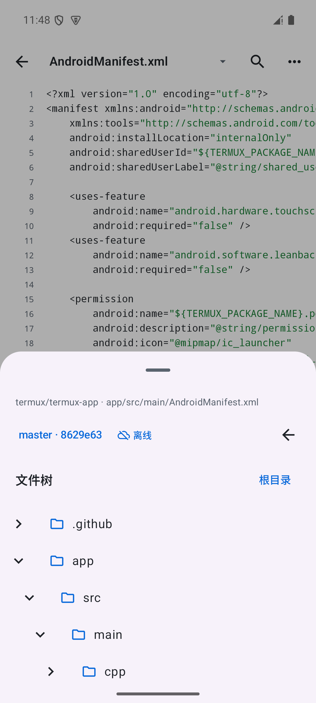
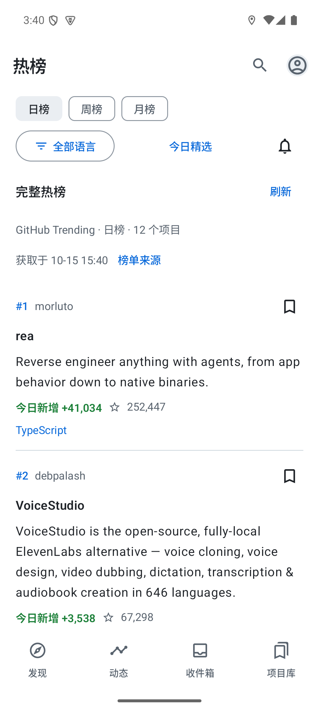

# RepoRove

**在 Android 上发现、阅读和收藏 GitHub 项目。**

[下载 APK](https://github.com/zurrll/RepoRove/releases) · [使用指南](docs/使用指南.md) · [更新记录](CHANGELOG.md) · [反馈问题](https://github.com/zurrll/RepoRove/issues)

Android 10+ · 预览版 · MIT 开源

&nbsp;
&nbsp;

## 能做什么

- **发现项目**：浏览完整 GitHub 日 / 周 / 月热榜、主题与合集，按兴趣寻找项目；每日精选提醒可自行开启。
- **搜索与阅读**：搜索仓库、代码、Issue、PR 和用户，阅读 README、文档与源码，查看文件树、语言占比和发布说明。
- **双语阅读**：自带 API Key，项目介绍和文档按段显示译文，原文、链接与代码保留。
- **收藏与回访**：稍后看、我的仓库、Star 集中管理；跟踪项目活动，查看个人和组织主页。
- **关注协作**：查看关注动态、GitHub 通知、Issue / PR 讨论、代码差异与 Actions 详情。
- **下载与离线**：下载 Release 附件，分别保存仓库资料和源码，断网后继续在 App 内阅读。
- **按习惯安排**：清晰 / 纸感主题、浅色 / 深色、字号和密度可选，导航与仓库栏目可自定义。

看看文档、源码与热榜

&nbsp;
&nbsp;

## 开始使用

到 [Releases](https://github.com/zurrll/RepoRove/releases) 下载 APK 安装；同签名预览版可覆盖更新。不登录也能浏览公开项目，需要 Star、自己的仓库和通知时，在“我的”通过 GitHub 官方网页授权登录。

最新公开版为 [0.6.3](https://github.com/zurrll/RepoRove/releases/tag/v0.6.3)。翻译需在设置中填写自己的服务 Key，按服务用量计费。

目前以浏览和阅读为主，评论提交、PR 审核、构建重跑等操作尚未完整提供。离线范围与登录说明见[使用指南](docs/使用指南.md)。这是独立客户端，与 GitHub 官方没有隶属关系。

## 告诉我们你的体验

欢迎[填写问卷星体验问卷](https://v.wjx.cn/vm/PA7J6G9.aspx)，或扫描下方二维码。遇到问题也可以提交 [Issue](https://github.com/zurrll/RepoRove/issues)。

[参与开发](CONTRIBUTING.md) · [隐私说明](docs/隐私说明.md) · [MIT License](LICENSE) · [第三方许可](THIRD_PARTY_NOTICES.md)
